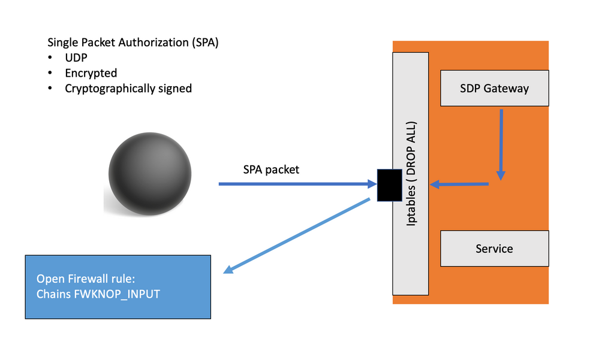

# SimpleSDP


A minimal, educational **Software-Defined Perimeter (SDP)** written in Python to illustrate Zero Trust network access: services stay hidden behind a default-drop gateway until an authenticated client is explicitly authorised by the controller.



## Architecture

| Component | Role |
|---|---|
| `controller/` | SDP Controller. TLS server with **mutual authentication** (client certificates) that keeps track of gateways and clients and decides who may access what. |
| `gateway/` | SDP Gateway. Connects to the controller over mTLS and, when an access is authorised, temporarily starts **fwknopd** so the client can open the protected service with **Single Packet Authorization (SPA)**. |
| `client/` | Initiating host. Authenticates against the controller over mTLS and then knocks on the gateway with an SPA packet. |

All three run as containers on an isolated Docker network (`sdp-net`), and share their certificates through `./data/certs`.

## Getting started

1. Create a CA and issue certificates for the controller, gateway and client, and place them in `data/certs/` (see [antoniopaya22/mTLS](https://github.com/antoniopaya22/mTLS) for mTLS examples).
2. Build and start the environment:

   ```bash
   docker compose up -d --build
   ```

3. Follow the logs of each component:

   ```bash
   docker compose logs -f sdp-controller sdp-gateway sdp-client
   ```

The controller listens on port `5000`.

## Related work

- [Software-Defined-Perimeter](https://github.com/antoniopaya22/Software-Defined-Perimeter): full SDP deployment based on the Waverley Labs implementation.
- [SPA-Example](https://github.com/antoniopaya22/SPA-Example): standalone Single Packet Authorization lab with fwknop.
- Payá *et al.*, [SecureSDP: A Novel Software-Defined Perimeter Implementation for Enhanced Network Security and Scalability](https://doi.org/10.1007/s10207-024-00863-7), *International Journal of Information Security* (2024).

## License

See [LICENSE](LICENSE).
